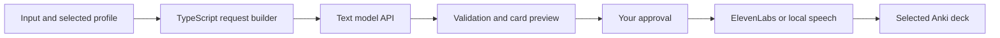

# AI generation, deck destinations, and customizable profiles

**Version:** 0.1  
**Date:** October 11, 2026  
**Status:** Production workflow design. Separate [Anki feasibility](ANKI_FEASIBILITY.md) and [text-model feasibility](TEXT_FEASIBILITY.md) experiments have evidence; production worker/settings/UI integration remains unimplemented.

## What the different choices mean

| Choice | What it controls | Example |
|---|---|---|
| Text provider and model | Which service generates written content | Unresolved after AV-005; adapter remains replaceable |
| Prompt | Teaching instructions, language, tone, and content | Your B1-to-B2/C1 English-coach instructions |
| Card structure/template | Fields and how they appear on each side | Target and sentence on front; explanations on back |
| Audio selection | Which fields are spoken and where clips appear | Front sentence and additional examples |
| TTS provider and voice | Which service reads approved text aloud | ElevenLabs with an American English voice |
| Destination deck | Where the resulting cards belong in Anki | `English::Work and everyday life` |

A deck groups cards for study. Its name does not define their field layout. A profile groups the prompt, structure, rendering rules, and audio selection. Different profiles may produce cards for the same deck.

## A real example, step by step

Input: `draining (context: Back-to-back meetings can be draining.)`.

1. **Configure the services once.** Select the written-content provider/model and enter its API key in settings. Configure ElevenLabs separately for speech. AV-005 evaluated Groq and Gemini without adopting either for production; a later decision must select and validate a provider. ElevenLabs is the confirmed hosted speech provider in this historical desktop design. The settings UI described here remains planned; AV-005 uses local backend environment variables.
2. **Start a batch.** Choose the English Coach profile and destination deck. The import preview separates the target `draining` from its context. Save this input so a failure will not lose it.
3. **Build the AI request.** Our TypeScript code combines the selected profile's teaching instructions, the target/context, and an output schema describing the profile's fields. The schema tells the model where to put its meaning, examples, pronunciation guidance, and translations. Adapt transport instructions in a separately versioned operational prompt; keep the original user prompt archived intact.
4. **Call the model's API.** A TypeScript provider adapter sends that request from the processing worker. We use an existing model; there is no model training, chat-window automation, or autonomous agent required. The provider returns generated data and available usage metadata. Hosted generation sends the submitted target/context to that provider; the deck name and unrelated library content need not be sent.
5. **Validate and display a draft.** Zod checks field types and required content. Profile-specific checks enforce example counts and conditional irregular forms. The renderer builds the visible front and back in the requested order. Correct JSON does not prove correct pronunciation or natural English, so the card remains a draft for your review.
6. **Review and approve.** You can edit or regenerate the draft. Approval records the exact content revision and profile version. An edit clears approval; failed or incomplete responses cannot proceed automatically.
7. **Generate the approved audio.** The app reads the configured sentence fields and sends their plain text to ElevenLabs, or invokes the local speech adapter. ElevenLabs reads the approved sentences; it is not the selected service for writing these definitions and translations. Save each clip locally and show replay controls.
8. **Deliver to the selected deck.** With Anki desktop running and AnkiConnect installed, refresh its deck list and select your destination. Check the destination and included cards in the final preview, then send the approved cards and audio directly. Package export as `.apkg` is also retained for manual import. Anki handles study scheduling and synchronization.

The app owns the workflow, saved data, validation, and approval rules. The text model writes learning content. The speech engine produces audio. These responsibilities have separate adapters so a provider can change without rewriting the interface.

## What happens when something fails

- Save one input and one draft revision at a time. Retry only failed items, with bounded retries and rate-limit handling.
- Reject truncated or malformed responses and show the reason. If a repair request is supported, it has a retry limit and consumes the provider's available allowance.
- Keep successful drafts available during network loss or quota exhaustion. Do not silently use a paid model or switch providers.
- Record provider/model, profile version, request identifiers where available, and usage/latency metadata. Never include keys in logs, exported cards, or backups.
- Test the orchestration with fake providers. Separately evaluate representative real outputs for naturalness, translations, IPA, and adherence to the selected profile.

## Can we write everything in TypeScript?

Yes: all custom application code can be TypeScript. React UI files use `.tsx`; provider requests, database access, approval rules, jobs, and Anki adapters use `.ts`. Build tools compile this into JavaScript. Styling still uses CSS, and dependencies have their own implementations.

There is no planned Python application backend. However, the current local speech proposal invokes Piper as an external tool, with a Python runtime and voice files. That makes these two requirements different:

| Requirement | Effect on the proposal |
|---|---|
| Write our application entirely in TypeScript | Supported by the current stack, including a TypeScript wrapper around Piper |
| Require no additional Python runtime on the user's computer | Revisit the local speech engine/runtime and validate Windows packaging, offline audio export, voice quality, and licensing before selecting a replacement |

The first release still requires one local and one hosted speech integration. Do not remove local speech to achieve the second requirement without a scope decision. Browser speech playback alone is not an established solution for exporting audio files into Anki.

## Destination-deck selection

The selected deck belongs to delivery settings, separate from the prompt and profile. Persist it with the batch, allow changes before delivery, and show it in the final preview. Changing only the destination does not invalidate approved content or cached audio, and must not create a new note identity.

Two delivery modes are possible:

- **Package export:** choose an app-known deck or enter a destination deck name, generate `.apkg`, and import it in Anki. This mode does not automatically discover decks in an Anki collection. Verify existing-deck matching and update behavior through real import tests; package import options can affect placement.
- **Direct connection:** with Anki desktop running and AnkiConnect installed, retrieve the actual deck list and send approved notes/media to the selected deck. Implement this as a TypeScript adapter over its local HTTP API. Refresh the list, report connection failures, and verify that the destination is writable before sending. Keep a delivery manifest and external note IDs to support recovery and avoid duplicate insertion after a partial failure.

**Confirmed first-release decision:** list existing Anki decks and send approved cards/audio directly to the selected deck. Package export remains a portable alternative. Never edit Anki's collection database directly or silently move previously delivered cards when changing the batch destination.

Direct delivery must:

- Connect only to the configured loopback endpoint; report missing Anki/add-on or unsupported API versions. Keep any connection key in protected credential storage.
- Refresh available decks and verify the selected destination before delivery. Report stale, removed, or unsupported destinations rather than silently using the default deck.
- Create or verify the app-owned note type for the selected profile. An existing destination deck does not require replacing its other note types or templates.
- Upload locally saved media and reference its filenames in the note fields. Keep app-generated filenames unique and record per-item delivery status.
- Include a reserved, hidden source-note identifier in app-owned note types, outside visible learning content. Save Anki's assigned note ID; after a timeout, query by source identity and verify the match before creating a replacement. Do not rely on matching the vocabulary word alone.
- Update a known note's fields rather than delete/recreate it, with scheduling preservation verified in the pilot. Report conflicting edits made in Anki for review.
- Bind external IDs to the paired Anki collection/profile. Require re-pairing and reconciliation after switching profiles; a numeric note ID alone is not portable.
- Treat AnkiConnect-created IDs/GUIDs and package identities as separate until reconciled. Block sending already delivered notes through the other mode until that reconciliation has been implemented and tested; do not promise cross-mode duplicate prevention from a shared app ID alone.

AnkiConnect's historical API documents deck listing, note creation, and media operations. Its upstream moved from GitHub to SourceHut; check the current API and installed add-on compatibility during the proof of concept. The current SourceHut documentation could not be inspected in this review, so historical documentation establishes feasibility, not a release guarantee.

## Future custom prompts and card structures

**Confirmed future feature:** users can supply their own prompts and choose their own card structure. They are not required to use the English Coach headings or fields. The first release ships only the built-in profile; design its engine around profiles now, and deliver the custom-profile editor later.

Each versioned `GenerationProfile` contains:

- A name, identity, version, and user prompt.
- Field definitions: stable keys, display labels, text/list types, required status, and validation constraints.
- Front/back field placement, order, and supported conditional sections, compiled into Anki note-type fields and templates.
- Audio selectors that identify text fields or list entries to speak, and the side/position of replay controls. Audio may be disabled for a profile.
- Profile-specific checks and the output schema generated from these definitions.

For example, a future **Short conversation** profile might use only `expression`, `example`, `simpleMeaning`, and `spanishEquivalent`. Another might use a question on the front and an answer with an explanation on the back. Neither inherits the coach profile's pronunciation or collocation requirements unless the user includes them.

The prompt and template must agree. If a user pastes only prose instructions, ask them to define the fields/layout, or propose an inferred profile for confirmation with a sample preview. Do not assume arbitrary prose tells the app which text belongs on each side or which sentences need audio.

Use structured output internally for reliable automation. Its outer envelope can keep stable metadata such as `profileId`, `profileVersion`, and `revision`; the learning fields and their validation come from the selected profile. This machine contract does not impose one visible card structure on all users.

### Architecture and compatibility rules

- Keep English Coach validators/rendering rules inside that profile. Generic draft storage, approval, TTS, and delivery code operate on the selected profile's field values.
- Record an immutable profile version with every draft, approval, job, and delivery. Regenerating with a changed prompt creates a new draft for review; editing a profile does not silently rewrite already studied notes.
- Assign stable Anki note-type identities per compatible profile layout. Treat field/template changes as compatibility decisions: use a new note type or an explicitly tested migration rather than overwriting an incompatible type or resetting study progress.
- Offer preview, validation, and a test card before enabling a custom profile for a batch. Support profile export/import without credentials so a group can share teaching instructions.
- Render escaped field values through supported declarative layouts. Custom prompts and layouts do not grant arbitrary JavaScript execution or filesystem access.
- The first implementation supports ordinary front/back notes. Advanced cloze or multiple-card note templates require separate export, identity, approval, and playback tests before being offered.

## Primary references

- [Groq structured outputs](https://console.groq.com/docs/structured-outputs): schema support depends on the selected model; validate capabilities during provider setup.
- [Piper project and setup](https://github.com/OHF-Voice/piper1-gpl) and [ElevenLabs JavaScript SDK](https://github.com/elevenlabs/elevenlabs-js).
- [AnkiConnect upstream relocation](https://github.com/FooSoft/anki-connect) and [historical official API documentation](https://github.com/FooSoft/anki-connect/blob/5b6fe5766c0e1ee476c78a9de1c085b37d817cd7/README.md).
- [Anki packaged-deck importing](https://docs.ankiweb.net/manual/importing/packaged-decks).

Reviewed October 11, 2026. This design does not select a final text model, implement direct insertion, or establish tested Anki compatibility.
