# Local web plan: Anki Card and Audio Workspace

**Date:** November 2, 2026
**Status:** Product direction and initial requirements accepted; implementation has not started.

## Purpose

Build a small application that runs only on the user's computer, opens in a web browser, and works with the user's running Anki Desktop application through AnkiConnect. Its first useful outcome is to import or load English Coach cards, review them individually, generate and listen to selected audio, and safely create or update notes in an explicitly selected Anki deck.

The learning outcome remains more important than building a general card platform. The first version supports the app-owned English Coach note type. Any existing Anki deck can be selected as a destination, but arbitrary note types are not modified until their fields and templates can be mapped safely.

This direction supersedes Electron as the planned first application shell. The Electron proposal and experiments remain in Git as historical evidence. Hosted accounts, a public web deployment, and a second repository are not part of this local phase.

## Terms that affect the design

- A **deck** controls where cards are stored and studied.
- A **note type** defines fields and card templates; it controls how a card looks.
- A **note** stores the editable field values.
- Anki creates one or more **cards** from a note type's templates.
- An **audio item** is one exact text value associated with a specific note field or list entry, voice configuration, and generated media file.

Selecting any deck does not make every note type in that deck safe to edit. New cards use the app-owned, versioned English Coach note type. Existing English Coach notes can be loaded and updated. Other note types require a later explicit field-mapping workflow.

## First-release workflow

```mermaid
flowchart LR
    A[Connect to Anki] --> B[Select existing deck]
    B --> C{Choose source}
    C -->|Paste or import| D[Validate card list]
    C -->|Load from Anki| E[Read supported notes]
    D --> F[Review and edit one by one]
    E --> F
    F --> G[Preview front and back]
    G --> H[Approve exact card revision]
    H --> I[Select target and example audio]
    I --> J[Generate one, selected, or all missing]
    J --> K[Listen and approve clips]
    K --> L[Create or update Anki notes]
    L --> M[Open in Anki Preview]
```



### Connect and choose a deck

- Show Anki/AnkiConnect connection status and the active session or collection pairing.
- Load and refresh all existing decks, including nested decks.
- Require the user to choose a destination. Never use a silent default deck.
- Revalidate the connection, collection pairing, and destination immediately before a write.
- Treat reconnecting or changing the Anki profile as a new pairing decision; do not trust stale numeric IDs.

### Paste, import, or load cards

The initial source modes are:

1. Paste one or more cards in the official English Coach text structure.
2. Import UTF-8 TSV, CSV, or structured JSON using documented columns/fields.
3. Load supported existing notes from the selected Anki deck through AnkiConnect.

The import preview must show invalid rows and detected boundaries before cards enter the review queue. Original source text remains available for comparison. Importing or loading performs no generation, media upload, or Anki mutation.

The application also offers **Copy card text** for a reviewed card. Copying never changes Anki.

### Review cards one by one

Each queue item shows a distinct status such as:

- Ready
- Needs attention
- Edited
- Audio incomplete
- Ready to send
- Already in Anki
- Update available
- Failed

The user can open a card, edit fields, include or exclude it, navigate between cards, see validation issues, discard unsaved edits, and preview both sides. Existing-note updates show a field-level before/after comparison. The browser preview uses the versioned English Coach template; a supported existing note can also be opened in Anki for final preview.

No structurally invalid card can be sent. A valid structure does not certify English quality, so user review remains required.

The user explicitly approves the exact displayed content revision before audio generation or delivery. The local server records and enforces that revision; the browser alone cannot manufacture approval. Editing any card field creates a new revision, clears content approval, and makes its prior audio associations ineligible for delivery until the new revision is reviewed and approved.

### Select audio text

For English Coach, audio is selected from:

1. `target` — the vocabulary word, phrase, expression, or complete target sentence.
2. `frontExample` — the front example sentence.
3. Every item in `examples` — the additional examples.

Meanings, headings, category, irregular forms, IPA, pronunciation guidance, chunks, usage notes, alternatives, and Spanish translation are not spoken by default.

With four additional examples, a card has six audio placements. A useful fifth example raises it to seven. Identical text/configuration may reuse one media artifact while retaining separate field associations.

Before generation, show every extracted item with its source field, include control, character count, and status. The user can edit card text before generation; audio generation itself never rewrites or corrects that text.

The server rejects audio work for an unapproved or stale card revision. Selecting audio items does not approve content.

### Generate and review audio

Provide three actions:

- **Generate this item**
- **Generate selected**
- **Generate all missing**

Before a batch, show the provider, voice, format, clip count, total characters, and any allowance information supplied by the provider. Do not imply a price or remaining quota that the provider did not report.

Generate a separate MP3 or WAV artifact for each distinct request. Cache matches require exact text, provider, model and version when available, voice and version when available, settings, and format. Preserve successful clips when another item fails. Resume only missing or explicitly selected failed work. Never switch provider/model or enter a paid path automatically.

The user can play every proposed clip before delivery. A clip is not associated with the current card revision when its source text has changed. Editing selected text marks its old association stale; the matching new clip must be generated or deliberately reused after exact-match verification.

### Create and update Anki notes

- Show whether each selected item will create a new note, update an existing supported note, or be omitted.
- Show the destination deck, note type, card count, audio readiness, and validation status before writing.
- Recheck exact content approval outside the browser immediately before delivery. Reject an unapproved revision or an approval that refers to older field values.
- Upload media with unique safe filenames and insert references into dedicated audio fields; do not mix sound tags into source sentence fields.
- Persist or reconcile the app-owned source identity and external note/type/card identifiers.
- Repeated delivery of the same current revision must not create a duplicate or unnecessary audio request.
- Update an existing note in place. Preserve note/card identity and scheduling; never delete/recreate a studied note to replace content or audio.
- Treat an ambiguous external completion as unresolved and reconcile by source identity before retrying a creation.
- Report per-item success and failure instead of presenting partial delivery as complete.

### Replace existing audio

For a supported existing note:

1. Choose the target or example audio placement.
2. Play the current clip when available.
3. Generate or select a proposed replacement.
4. Compare the current and proposed clips.
5. Confirm the replacement.
6. Upload a new uniquely named media file and update only the intended audio reference.
7. Re-read the note and identity/scheduling evidence needed to confirm the update.

Do not overwrite the old file in place: Anki media synchronization and local caches may retain it. Do not delete the old file automatically because another note may reference it. App-owned orphan-media cleanup is a separate feature that must check references first.

## Local architecture boundary

The first implementation remains in this repository and uses one npm workspace/package until separation is justified:

```text
src/
  core/          Profiles, validation, revisions, audio selection
  server/        Loopback HTTP service, providers, AnkiConnect
  web/           React browser interface
  experiments/   Preserved AV-004/AV-005 tools
```

- The React web interface displays data and sends typed commands. It receives no provider keys and cannot call arbitrary filesystem or process operations.
- The local Node server binds to loopback only, validates command bodies and browser origin/session tokens, owns provider calls and local artifacts, and talks to AnkiConnect.
- Anki remains the system of record for delivered notes, scheduling, decks, and synced media.
- Initial local configuration may use process/user environment variables. A later settings design must keep secrets outside browser storage, logs, cards, exports, and Git.
- Persistence beyond Anki should be added only for demonstrated needs such as resumable imports, pending audio, and delivery reconciliation. SQLite is not assumed for the first vertical slice.

## Reuse from completed work

| Existing result | Local web use |
|---|---|
| AV-002 TypeScript/React/Vite tooling | Reuse and adapt; Electron-specific shell is provisional history |
| AV-003 profile, revision, approval, speech, and delivery contracts | Reuse after narrowing them to the local workflow |
| AV-004 Anki adapter and reconciliation evidence | Reuse deck discovery, session guards, media upload, identity, and in-place update behavior |
| AV-005 prompts, English Coach profile, schemas, cases, and raw evidence | Reuse content structure and validation; no provider is adopted |

## Initial acceptance scenarios

The first vertical slice is acceptable when all of the following are demonstrated with a disposable Anki profile:

1. Connect and select an existing nested deck; disconnecting or changing the session blocks writes.
2. Paste/import at least five English Coach cards, show invalid input, and retain valid items.
3. Review and edit every card individually with accurate front/back previews.
4. Block audio and delivery for an unapproved revision; approve it, then edit a field and prove that the stale approval is invalidated outside the browser.
5. Extract target, front-example, and additional-example audio items without selecting other learning fields.
6. Generate one clip and all missing clips; preserve completed items through a controlled partial failure.
7. Listen to every generated clip before delivery.
8. Create the selected notes in the chosen deck with the expected note type and media.
9. Repeat the same delivery without duplicates or unnecessary regeneration.
10. Load one delivered note, replace one clip after comparison, and update it without changing note/card identity or scheduling.
11. Report exact real results separately from fake-provider/error checks and leave human language/voice approval pending until performed.

## Deferred from the first vertical slice

- Arbitrary Anki note-type editing and automatic field inference
- `.apkg` package export
- Multiple production TTS providers
- Automatic media deletion or collection-wide cleanup
- Electron packaging and a Windows installer
- Hosted deployment, accounts, authentication, and multi-user storage
- Fifty-item scale and durable background processing
- New written-card generation provider selection
- The separately discussed general-purpose Audio Studio beyond supported English Coach notes

## Planning decisions still required

Before audio implementation, select and listen to the first TTS provider/voice and confirm its allowance. Before import implementation, freeze examples for each supported TSV, CSV, JSON, and pasted-text format. Those decisions do not block the local shell, Anki connection, deck selection, queue, or fixture-based preview work.
