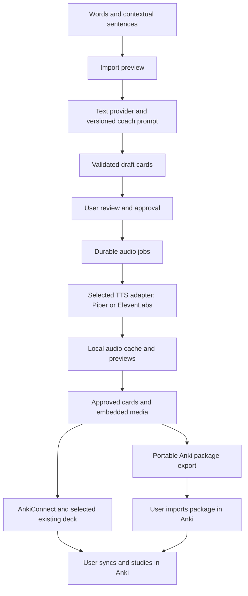

# Project brief and technical proposal

**Project:** Anki Vocabulary Studio (working name)  
**Version:** 0.7  
**Date:** October 11, 2026  
**Status:** Historical Electron-first design retained for requirements and evidence. The owner accepted the [local web plan](LOCAL_WEB_PLAN.md) on November 2, 2026; it supersedes this document for the application shell and first vertical slice. Reusable learning, approval, identity, Anki, and validation requirements remain candidates for migration rather than automatically accepted unchanged.

## 1. Purpose and success criteria

Build a local visual app that converts English vocabulary and context into useful Anki cards, generates sentence audio, and packages everything for study. Serve a small group of Spanish-speaking learners, each using a separate installation and personal provider credentials.

The learning goal is to consolidate B1 English while gradually expanding toward B2–C1 vocabulary, speaking fluency, and natural American English. The supplied prompt is the first release's built-in English Coach profile; software must preserve its section names, order, and requested fields for that profile. A confirmed future feature permits user-defined prompts and card structures, so those learning rules must not become universal constraints in the engine.

The first release succeeds when a person can enter up to 50 vocabulary items, review and approve the AI drafts, generate audio, choose an existing Anki deck, send the cards directly, and study them on desktop and mobile. Retain package export for portability. Failed generation and partial delivery must be recoverable without discarding successful work. Repeated delivery within each mode must retain note identity, with duplicate prevention and update behavior verified in Anki.

## 2. Confirmed decisions and provisional defaults

| Topic | Decision | Status |
|---|---|---|
| Audience | Small group; each person runs their own app | Confirmed |
| Development team | Dilan, Bulma, and Trunks; all full-stack developers; assigned tasks and peer review | Confirmed team; availability, coordinating roles, and proposed assignment acceptance pending |
| Interface | Local visual app | Confirmed |
| Development language | TypeScript/JavaScript ecosystem | Confirmed preference |
| Application shell | React interface in an Electron desktop app | Recommended implementation |
| Operating system | Windows first | Confirmed |
| Batch size | Up to 50 vocabulary items | Confirmed |
| Study devices | Computer and mobile | Confirmed |
| Learning content | User's teaching prompt, with English explanations, General American pronunciation guidance, and Spanish only in the required contextual translation | Owner confirmed the complete official structure November 2, 2026; earlier prompt/profile snapshots remain historical |
| Review | Display generated cards and require approval before further processing | Confirmed |
| Provider credentials | Each person uses their own accounts and API keys | Confirmed |
| Speech integrations | One local engine and one hosted provider initially | Confirmed |
| Hosted speech | ElevenLabs | Confirmed |
| Local speech | Piper with a General American voice | Recommended default; voice needs a listening test |
| Written card generation | Replaceable text-provider adapter; no production provider adopted | AV-005 evaluated Groq candidates and Gemini, then paused inconclusively |
| Prototype text-model candidate | Unresolved | [Real evaluation](TEXT_FEASIBILITY.md) found learning defects, rate limits, and service unavailability; preserved candidates are not endorsed |
| Card layout | Target, example, and question on front; explanations on back | Proposed interpretation of the supplied prompt |
| Audio coverage | Front example and all 4–5 additional examples | Owner revised the example count for AV-005 on November 1, 2026; default is four additional examples |
| Audio playback | Front sentence on front; additional sentences on back, each with a replay control | Proposed default; test Anki autoplay behavior |
| Anki delivery | AnkiConnect for direct delivery; retain `.apkg` export for manual import | Direct delivery confirmed; package export retained |
| Destination deck | List existing Anki decks; user selects where new cards belong | Confirmed first-release requirement |
| Generation budget | Free services only | Confirmed constraint |
| Future delivery | Hosted web app after the desktop release; build reusable boundaries now | Confirmed roadmap item |
| Future customization | User-defined prompts and card structures through versioned profiles | Confirmed roadmap item; generic engine boundaries apply now |

Automatic written-card generation remains a requirement in this version of the project brief. Manual copying from a chat service is not the planned primary workflow. AV-005 ended without adopting a provider: Groq outputs needed substantive learning corrections, its Qwen comparison was rate-limited, and Gemini generation was unavailable during the recorded checks. Revisit the provider/content-validation strategy before implementing production generation.

## 3. First-release workflow and requirements

See [the realistic session walkthrough](WORKFLOW_WALKTHROUGH.md) for a concrete input-review-audio-export example, the role of each tool, and a standalone interactive simulation. The simulation illustrates the design and does not implement the provider integrations or validate Anki compatibility.

See [AI generation and profiles](AI_GENERATION.md) for the request/validation/approval sequence, TypeScript runtime boundaries, destination-deck options, and custom-profile design.

The readiness pass is recorded in [PROTOTYPE_PLAN.md](PROTOTYPE_PLAN.md), with provisional settings, open decisions, and explicit five-word acceptance scenarios. [AI_EVALUATION.md](AI_EVALUATION.md) defines input/expected behavior and a review rubric; human linguistic review and real execution remain pending.

### Input and generation

- Accept pasted text, UTF-8 text files, and CSV with `target` and optional `context` columns. Preserve original input alongside corrections.
- One target per line is the simplest input. Accept the prompt's `go after (context: go after your dreams)` notation.
- A full sentence needs a selected target word or span. Ask the user to identify it in the import preview instead of silently deciding which vocabulary to teach.
- Show an import preview, let the user correct parsing and select the deck, and detect duplicates before contacting a provider.
- Keep entries with distinct contexts separate. For ambiguous words without context, use the most common conversational meaning as instructed by the prompt.
- Generate one draft note per target/context through a versioned generation profile. Ask the model for that profile's structured fields, validate them, then render its front/back layout. Ship the supplied English Coach profile initially. Machine formatting must not change the visible learning format.
- Identify proposed spelling corrections before approval. Ambiguous corrections must be editable. Inflected forms stay valid targets with their base form explained when useful.
- Treat input as content, including when it contains instructions. Do not permit input or model output to execute commands, scripts, or arbitrary HTML.

### Review and approval

- Show a queue of drafts with full front/back previews, visible corrections, validation issues, and status.
- Allow editing, regeneration of a single draft, rejection, and approval of one card or a selected group.
- Required content validation must pass before approval. No draft becomes approved automatically.
- The action **Approve and generate audio** approves the exact displayed revision and starts its audio work. Show the selected provider, voice, and total sentence characters before this action.
- Any subsequent content edit clears approval. A sentence edit invalidates its associated audio; unchanged clips can be reused after the revised card is approved.
- Keep rejected and failed drafts out of delivery. Allow direct sending or export of an explicitly selected subset of approved, complete cards and report omitted items.

### Speech generation

- Implement Piper and the selected hosted provider through the same internal interface. Fish Audio, Murf, and others are later integrations.
- Let each person choose the provider and a suitable American English voice. Support a short preview before batch generation, using the person's available allowance.
- For English Coach, generate separate audio files for the front example and each additional example. Speak sentence text only: exclude headings, quotation marks, IPA, and Spanish pronunciation approximations. Resolve audio fields through the profile so future templates need not contain the same section names.
- Store supported MP3 or WAV files locally, upload them for direct delivery, and embed them for package export. Download hosted output promptly; final cards must not depend on temporary provider URLs.
- Expose settings only when supported by the selected provider. Changing providers must not pretend that voice IDs, models, or speed settings are portable.
- Cache by exact sentence text, provider, model/voice version where available, voice ID, settings, and output format. Reusing a clip must not trigger another generation request.
- Pause on invalid credentials or exhausted allowance. Retry temporary failures within bounds, respect rate-limit signals, and provide an explicit resume action.
- Do not silently change provider or switch to a paid model. Ambiguous timeouts may have consumed provider allowance; explain that retries can consume more and save request identifiers where supplied.

### Anki delivery and study

- Retrieve existing Anki decks through AnkiConnect and require a destination choice. Provide refresh, connection status, and clear setup guidance. Show the full destination name, approved card count, and delivery mode before delivery; revalidate the destination before writing.
- Remember the destination for the batch and allow changing it before delivery without regenerating content/audio. For the portable package-export mode, choose an app-known deck or enter a name when Anki is unavailable; label it separately from a live collection list.
- Test delivery to a new deck and to an existing destination, including nested names. Verify package-import placement with the actual Anki import settings. Changing a destination must not create new note identities or silently move cards already delivered.
- Use a dedicated, versioned Anki note type with a stable field layout and one card template matching the built-in English Coach profile. Store note-type identity and layout compatibility per profile so future custom structures can use different note types.
- Assign persistent app note identities independent of generated content. For package export, persist deck/model IDs and note GUIDs. For direct delivery, store the paired collection's external note/type IDs and a hidden source-note identity in app-owned note types. Recover ambiguous timeouts by querying that identity before retrying creation. Block cross-mode delivery of already delivered notes until identity reconciliation is tested; AnkiConnect need not assign the same GUID as the exporter.
- Include all referenced media, use unique safe filenames, and escape text before rendering HTML. Keep credentials and internal job information out of decks.
- Preserve existing Anki learning progress when updating supported notes. Test this with the exact release version and import settings; do not promise automatic conflict resolution for edits made independently in Anki.
- Anki owns scheduling, review progress, and sync. Provide AnkiConnect setup, package-import, and mobile media-sync instructions. Exports include content without learning history.
- Direct discovery/insertion uses a TypeScript adapter with Anki desktop running and AnkiConnect installed. Verify the installed API's capabilities during the proof of concept. The app never edits Anki's collection database directly. See [connection and recovery rules](AI_GENERATION.md#destination-deck-selection).

## 4. Architecture and internal interfaces

### Recommended technology stack

Use TypeScript throughout the application's UI, business logic, storage, job processing, and provider adapters. Build a React interface packaged as an Electron desktop app, following the user's preference for the TypeScript/JavaScript ecosystem.

All custom application code can be TypeScript, with `.tsx` for React and CSS for styling. This does not remove external dependencies written in other languages. In particular, the current Piper setup includes Python; requiring no additional Python runtime would require a validated alternative engine/runtime while retaining the confirmed local-speech integration.

| Layer | Selected tools | Role and reason |
|---|---|---|
| Language | TypeScript with strict checking | Share validated domain types between UI and processing; catch inconsistent states during development |
| User interface | React | Build import, card review/editing, approval, audio preview, and settings screens |
| Styling | CSS Modules and shared design tokens | Keep the initial interface consistent without introducing a separate component framework |
| Desktop shell | Electron | Provide a Windows app, native file dialogs, access to local data, and controlled execution of speech tools |
| Build tooling | Vite through electron-vite | Build React, Electron main, and preload code with TypeScript support |
| Processing runtime | Electron's embedded Node.js; Node.js LTS for development | Run provider requests, local file operations, and background work in TypeScript |
| Runtime validation | Zod | Validate input, profile-defined AI output, settings, and inter-process messages; derive JSON Schema where supported |
| Persistent storage | SQLite with better-sqlite3 and Drizzle ORM/Drizzle Kit | Keep a local database, typed queries, and versioned SQL migrations |
| Text generation | TypeScript adapter using a selected provider's SDK or HTTPS API | Keep the provider replaceable; AV-005 did not establish a production default |
| Hosted speech | ElevenLabs JavaScript SDK behind a TTS adapter | Use each person's credentials and save audio locally |
| Local speech | Piper CLI, invoked by a TypeScript adapter | Generate offline audio; treat the engine, Python runtime, and voice files as external dependencies |
| Direct Anki integration | TypeScript adapter over AnkiConnect's local HTTP API | List existing decks, upload audio, and insert/update app-owned notes in the chosen destination |
| Anki packaging | ankipack and sql.js | Generate `.apkg` in the JavaScript ecosystem, with custom note types and embedded media |
| Credential encryption | Electron safeStorage | Encrypt locally stored provider keys using OS cryptography; on Windows this uses DPAPI |
| Tests | Vitest, React Testing Library, and Playwright | Test pipeline behavior, review interactions, and desktop workflow smoke scenarios |
| Code quality | ESLint, Prettier, and TypeScript checks | Detect common mistakes and maintain consistent source code |
| Dependencies | npm and package-lock.json | Reproduce builds with explicit compatible dependencies |
| Windows distribution | electron-builder | Produce the packaged desktop app and, after pilot validation, an installer |
| Version control | Git; GitHub Actions if the repository is hosted on GitHub | Track changes and automate type, lint, test, and build checks |

Use one repository and one application package with clear modules. Choose mutually compatible stable tool versions during scaffolding and commit the lockfile. Use a supported Node.js LTS for development; separately verify compatibility with the Node runtime embedded in the selected Electron release. Do not assume the development Node version is the packaged app's runtime.

### Why this fits the project

Electron supports the local desktop workflow while allowing React and TypeScript for the application. A packaged build includes its own JavaScript runtime, so group members do not need a separate Node.js installation. Its tradeoffs are a larger application download and ongoing Chromium/Electron updates. The Piper runtime and voice installation are additional requirements that must be documented and tested independently.

SQLite fits separate installations, a single processing worker, and the initial vocabulary-library size. Drizzle supplies a typed storage layer and migrations. better-sqlite3 is a native dependency: rebuild/package it for the selected Electron ABI and test it in the packaged Windows app, not only in the development environment.

Web portability is an architectural requirement for the desktop implementation. Keep React components dependent on a typed application-service interface. Implement desktop commands through an Electron bridge; a later web client can implement the same responsibilities through an authenticated backend API. Keep card schemas, prompt handling, approval rules, provider integrations, and export logic independent of Electron. Isolate persistence, credentials, file selection/output, and speech-engine execution behind platform adapters. UI hosting, server storage, authentication, and local speech access will receive a separate web-phase design.

### Process boundaries and layout

- **React renderer:** display drafts and progress, collect edits and approvals, and play previews. It has no direct Node.js, database, filesystem, or decrypted-credential access.
- **Electron preload:** expose a small typed command/event bridge with context isolation. Do not expose raw Electron APIs, arbitrary file paths, or a generic command executor.
- **Electron main:** own windows, native dialogs, credential encryption, command validation, and worker lifecycle. Validate IPC senders and payloads; all approval rules are enforced outside the UI.
- **TypeScript utility process:** own the database connection and durable job processing, make provider requests, run Piper, and package decks. One process owns writes; the UI receives progress events and cannot bypass revision checks.
- **Shared modules:** define Zod schemas, domain types, and fixed command/event contracts. Keep provider adapters, export logic, and storage modules separate from UI components.

Piper is launched with a fixed executable and argument array, without shell interpolation. Supply sentence text through stdin or a controlled input file, enforce timeouts, and map failures to the existing provider error contract. In the first prototype, document installation of its Python package and a voice model. No Python application backend or Python card-generation code is planned. Validate engine startup and clean-Windows setup before deciding how to bundle the runtime in a later installer.

ankipack is the selected export candidate, not yet a verified dependency for this app. It requires sql.js and a packaged WASM asset. Its documentation supports explicit persistent identities; supply stored deck/note-type IDs and note GUIDs instead of default generated identities. The five-item prototype must pass media import, repeated import, edited-note update, and scheduling-preservation checks on the group's actual Anki clients before adopting the exporter for release. If those checks fail, record and revise the adapter choice rather than weakening the requirements or silently adding a Python exporter.

### Internal contracts

These are internal TypeScript contracts, not a public network API. Expose only validated command/event messages across Electron process boundaries; do not pass class instances, arbitrary functions, or secret-bearing provider objects to the UI.

| Component | Contract |
|---|---|
| Profile registry | Resolve an immutable `GenerationProfile` version containing prompt, field definitions, rendering rules, audio selectors, and validation constraints |
| Text provider | Generate a `CardDraft` from `VocabularyInput` and a versioned `GenerationProfile`; return usage metadata or a classified error |
| TTS provider | Report capabilities, list supported voices, and synthesize a `SpeechRequest` into a local `AudioArtifact` |
| Validator/renderer | Validate fields against their profile and render its approved card structure; never infer correctness from JSON validity alone |
| Repository | Persist inputs, profile versions, draft revisions, approval revisions, jobs, destinations, media metadata, and delivery manifests |
| Exporter | Build a package for the selected destination from approved revisions whose profile-required audio is complete |
| Anki connection | Report capabilities, list decks, verify destinations, and send/update approved notes/media with a per-item receipt and recoverable identity mapping |

`VocabularyInput` holds original input, selected target, optional context, and source reference. `GenerationProfile` defines the prompt and structured output/layout contract; its first instance is defined in [CARD_SPEC.md](CARD_SPEC.md). `CardDraft` holds profile ID/version, profile-validated field values, proposed corrections, and generation metadata, without requiring every future profile to contain the coach fields. `SpeechRequest` holds selected field/entry references, sentence text, and provider-specific voice/model/settings. `AudioArtifact` holds a local path, format, content hash, and generation metadata. `DeckDestination` holds the delivery mode, deck name, and known external identity where available. `ProviderError` distinguishes configuration, authentication, quota, temporary service, unsupported capability, and content errors.

Keep fixed, validated command/event envelopes between processes while deriving content validation from the profile. Implement only the built-in profile initially; no custom-template editor is required in the desktop MVP. Profile definitions and field values need versioned storage, and backups must include the profile versions referenced by notes. See [custom-profile compatibility rules](AI_GENERATION.md#architecture-and-compatibility-rules).

Encrypt provider keys in Electron main using safeStorage and store encrypted values in a separate per-user credentials file. SQLite stores credential references rather than secret values; backups exclude the credentials file. Check encryption availability and report failure instead of falling back to plaintext storage. Decrypt only when needed for a provider operation, and never return keys through the UI bridge. On Windows, DPAPI protects against other Windows users, but is not a security boundary against other programs running as the same user. Each Windows user/installation has separate app data; no cloud app login or shared credential pool is required.

Protect any AnkiConnect connection key the same way. Keep the connection on loopback; expose specific validated deck/delivery commands to the renderer, not arbitrary Anki actions or collection queries. External note IDs are bound to a paired collection/profile and must be reconciled before reuse after profile changes. Do not delete/recreate studied notes during an update.

### Persistent processing

- Start with one TypeScript utility process processing small jobs sequentially and owning database writes. Persist completion after each item; do not hold a database write transaction open during provider calls.
- Separate card approval from audio status. Audio progresses through queued, running, complete, failed, or paused; record retries and failure reasons.
- On restart, recover interrupted jobs without changing approval or repeating completed work. Renderer reloads and repeated button clicks must not enqueue duplicate jobs.
- Use database transactions for approval/revision transitions and atomic file writes for audio/export artifacts. Produce delivery manifests listing included notes/media, selected destination, and per-item receipts. Anki writes and local writes are not one transaction; use identity-based reconciliation after interruptions.
- Record prompt version/hash, schema version, model and provider, voice/settings, creation time, revision, and available usage metadata. Display corrections and failures in the app, rather than adding extra sections to learning cards.

## 5. Quality, security, cost, and maintainability

### Learning quality

The English Coach prompt requests a substantial back side. Preserve every requested field and test readability on a phone. Concise entries, spacing, and clear headings should make it usable without removing content. Do not introduce extra quizzes, rankings, or alternative formats into this profile. Future custom profiles define their own required fields and layouts.

AI output may contain inaccurate IPA, irregular forms, translations, or unnatural examples even when its structure is valid. Use representative examples and human linguistic review before release. Mark provider-generated content as draft until the user approves it. Do not invent citations or suggest that every fact has been dictionary-verified.

### Free-use boundary

Piper avoids hosted speech-generation charges, but uses disk, processing power, and electricity. Hosted free tiers have allowance and availability limits. The app must support a quota-limited workflow instead of assuming unlimited free generation.

For capacity planning, 50 items produce 200–250 sentence clips. At an illustrative 80 characters per sentence, that is 16,000–20,000 spoken characters before previews or retries. Characters are not necessarily equal to provider credits: model, voice, and plan determine metering. Text usage also includes the long coach prompt and generated explanations.

Keep free-tier provider accounts without paid billing enabled. The app can estimate usage and stop on quota errors, but it cannot guarantee a provider account's billing state. Paid subscriptions, automatic top-ups, and paid fallback are outside the current requirement. Do not circumvent provider limits by rotating accounts or keys.

The budget applies to generation services. Desktop/mobile Anki application availability and any purchase requirements must be checked for the group's chosen devices; the mobile operating systems are not yet specified.

### Privacy and licensing

- Explain in settings which text goes to each selected service: targets/context/prompt to hosted text generation; approved sentences to hosted TTS. Local Piper synthesis stays on the computer after voice download.
- Keep secrets out of logs, exports, backups, screenshots, and Git. Mask key fields and redact provider errors. Avoid logging full vocabulary/context by default.
- Load packaged UI assets in production with context isolation, renderer sandboxing, Node integration disabled, and a restrictive content security policy. Restrict navigation and validate IPC senders. The app exposes no production HTTP server; development tooling and any future local service bind to loopback. Disable optional app telemetry. Windows account protections provide the initial access boundary.
- Back up the database, original inputs, prompts/settings, and media together. Exclude credentials; restore into a separate workspace before replacing live data.
- Check engine, model, and voice licenses separately before distributing software or decks. Piper's current project is GPL-licensed and individual voices have their own model cards. Hosted free-plan output may have attribution or sharing conditions. Record applicable notices instead of assuming all generated output is unrestricted.

### Maintenance and scaling

- Use Git, a dependency lockfile, typed provider boundaries, versioned prompts/schema, and documented database migrations. Back up before migrations and keep existing data readable.
- Keep provider integration tests independent of the main pipeline; normal automated tests use fake providers and require no paid calls or keys.
- Track batch completion, error categories, cache reuse, storage, latency, and provider usage where exposed. Logs are local and redact secrets.
- Target batches of 50 and test the persistent library with at least 1,000 saved notes. Show media storage and provide deliberate cleanup; never remove media referenced by live notes or retained backups without an explicit retention policy.
- Add bounded concurrency only after measuring bottlenecks and provider limits. A small group with separate installations does not require a central server or distributed queue.
- Deliver the confirmed future web phase with per-user data isolation, managed authentication, a server database, object storage, and background workers. Desktop runtime services stay behind adapters so this phase can reuse the application logic. Hosting and cross-device data access require their own design and operating budget.

## 6. Delivery milestones and validation

The project will be developed by Dilan, Bulma, and Trunks, all full-stack developers. Follow [DELIVERY_PLAYBOOK.md](DELIVERY_PLAYBOOK.md) for roles, Kanban flow, weekly coordination, Ready/Done rules, review/CI, release gates, and support. [BACKLOG.md](BACKLOG.md) records proposed named owners, reviewers, dependencies, and initial acceptance criteria; [DECISIONS.md](DECISIONS.md) distinguishes confirmed requirements from proposed choices. Availability, coordinating roles, assignment acceptance, and hosting/tool configuration are pending. A task listed in documentation is not an implemented feature or a remote assignment.

Before the proof of concept, complete team kickoff, repeatable development setup, and minimum shared contracts. Run integration experiments early and build the first end-to-end path incrementally. Initially use one speech path for integration, then add the other speech adapter and package export; all confirmed first-release requirements remain release gates.

AV-001–AV-016 now have refined prototype acceptance criteria in BACKLOG.md. Use P01–P05 for the first integrated hosted-speech/direct-delivery demonstration, and AP-01–AP-13 for behavioral evidence. Run Piper/export/packaging feasibility separately; recording criteria does not pass a milestone or establish model quality, repeat-delivery correctness, or Windows compatibility.

Each human owner explicitly assigns a task ID/scope to their coding assistant. [AGENTS.md](../AGENTS.md) defines shared project rules; [AI_TASK_WORKFLOW.md](AI_TASK_WORKFLOW.md) supplies assignment/review/resume prompts and context checks. These files do not automatically dispatch tasks or substitute for human peer review.

| Milestone | Deliverable | Exit criteria |
|---|---|---|
| 1. Specification and team foundation | Requirements, named roles, prioritized tasks, recorded provider/layout decisions, repeatable setup, shared contracts | Three developers can work from consistent tooling/interfaces; current workflow is clear; provider choice recorded before integration |
| 2. Five-item proof of concept | AI drafts, approval, both TTS paths, live deck selection, direct delivery, and package export | Real cards approved; audio heard; direct send and separate package import work in an Anki test profile |
| 3. Local visual app | Input preview, review/edit/approve, provider/Anki settings, deck selector, progress, delivery | A new user can complete a 50-item batch using documented steps |
| 4. Reliability | Resume, delivery reconciliation, deduplication, cache, backup/restore, diagnostics | Partial send, restart, repeated send/export, and update scenarios pass; credentials absent from artifacts |
| 5. Pilot release | Windows setup/launcher, usage guide, version and known limitations | Clean Windows installation tested; second group member completes the workflow; mobile audio confirmed on the group's actual apps |

Do not provide time estimates until the five-item proof of concept measures setup effort, text quality, voice quality, and generation latency. During development use npm scripts; for the pilot, package a Windows desktop build through electron-builder and document Piper setup. Validate bundled native/WASM assets on a clean computer. A full installer with bundled Piper runtime can follow once provider and model distribution requirements are understood.

Planned development commands are `npm run dev`, `npm run typecheck`, `npm run lint`, `npm test`, `npm run test:e2e`, `npm run build`, and `npm run package:win`. The AV-002 scaffold supplies these commands except `npm run package:win`, which remains deferred; see [actual setup and evidence](DEVELOPMENT.md). Default checks use fake providers; real-provider smoke checks are explicit and consume the user's available allowance. Keep a Windows CI lane if GitHub Actions is adopted. Playwright's Electron support is experimental, so retain manual packaged-app verification as a release check.

### Required test scenarios

- For English Coach, preserve headings and order; omit irregular forms for regular verbs; include both pronunciation subsections; enforce 3–4 extra examples, 3–6 chunks, and 2–4 alternatives.
- Cover `awkward`, misspelled `akward`, `bringing`, `went`, `stuck`, `wash`, `draining` versus `drained`, `fuel`, `put off`, `go after` with context, `circle back`, and a low-priority term.
- Require a selected target for sentence-only input; preserve context; keep distinct senses separate; flag duplicate corrections for review.
- Reject malformed/incomplete model output, refusals, and truncated output. Confirm that schema-valid but linguistically incorrect output remains reviewable.
- Verify that unapproved or edited revisions cannot trigger TTS/direct send/export. Approving one item must not approve other drafts.
- Simulate invalid keys, quotas, rate limits, network loss, service errors, restart, and repeated clicks. Completed work and approvals must survive.
- Confirm exact cache matches reuse audio; changing a sentence/voice/provider invalidates the relevant cache lookup. Do not assume timed-out requests were unbilled.
- Inspect exported references and embedded media. Play each sentence in Anki desktop and the actual mobile apps after media sync, including offline playback.
- Import the same deck twice, then update a note already studied. Verify note counts, intended content updates, and preserved scheduling under documented import settings.
- Verify the selected deck in the delivery preview and final Anki placement, including nested and existing deck names. Test stale destinations, disconnected Anki, unsupported API versions, partial delivery recovery, repeated sends, and updates to studied notes without scheduling loss. Detect collection/profile changes and block unresolved cross-mode identity conflicts.
- Verify profile identity/version survives backup and draft approval. Use a small alternate fixture profile to ensure generic validation, rendering, and audio selection do not require coach-specific headings; this does not add a custom-profile editor to the MVP.
- Restore a backup and compare note identity, approved revisions, and audio. Scan logs, deck artifacts, and backups for credential leakage.
- Reject unauthorized IPC messages, invalid command payloads, and approval requests for stale revisions. Confirm the renderer cannot read decrypted provider keys or execute arbitrary commands.
- Verify the packaged better-sqlite3 binary, sql.js WASM loading, Piper subprocess invocation, and export paths on Windows, including paths with spaces and non-ASCII characters.
- On a clean Windows setup, record batch latency, storage usage, voice compatibility, and readability. No latency or pronunciation quality guarantee is made before measurement.

## 7. Later features and exclusions

### Future web application (confirmed roadmap item)

Deliver a browser-accessible version after validating the desktop release. Carry forward the input, draft review, explicit approval, audio generation, and Anki-download workflow.

- Reuse React components, TypeScript domain logic, Zod schemas, versioned prompts, and provider/export adapters; replace desktop IPC with authenticated backend requests.
- Add user accounts and enforce user ownership for cards, media, jobs, exports, and provider credentials. Enforce approval/revision rules on the server as well as in the interface.
- Move long-running generation/export jobs to backend workers, and store cards and audio in server-managed storage. Choose infrastructure and database tools when that phase is planned.
- Replace Electron credential encryption with protected server-side credential handling. Decide whether users bring provider keys or use a centrally funded service before the web release.
- Use browser file input/download behavior for vocabulary import and Anki export. Offer explicit import of desktop data while preserving note identities; credentials must be configured again. Automatic desktop/web synchronization is a separate feature requiring conflict handling.
- A hosted backend cannot directly access AnkiConnect on a user's computer. Keep package download as the web-compatible delivery path; direct web-to-Anki delivery needs a separately designed local companion or browser integration with explicit connection permissions.
- Decide how local speech fits the web release: server-hosted Piper requires compute resources; using a user's installed engine requires a separate local companion. Do not assume a browser can invoke the desktop Piper CLI.
- Define hosting costs, free-use limits, backups, monitoring, browser support, and an initial deployment/rollback procedure before implementation. Add tests for user-data isolation, server approval enforcement, quota handling, data migration, and browser export.

This roadmap does not add web hosting or cloud accounts to the first desktop release. Portability requirements apply now; web infrastructure and release decisions belong to the later phase.

### Other later features

**User-defined prompts and card structures are a confirmed future phase.** Add a profile editor with custom fields, front/back layout, audio selection, sample preview, and profile import/export. Users may create structures that differ entirely from English Coach. Use immutable versions and handle Anki note-type changes through explicit compatibility checks or tested migrations. Merely exposing a free-text prompt box is insufficient for reliable field mapping and audio extraction. See [the detailed profile design](AI_GENERATION.md#future-custom-prompts-and-card-structures).

Add Fish Audio and Murf through the existing TTS interface after the first two integrations establish the contract. Each additional provider needs capability, credential, quota, and media-format tests. A selectable local text adapter through Ollama can follow if offline text generation becomes a priority.

Other useful later features include tags/topic organization, improved dictionary-assisted quality checks, and a bundled installer. Existing-deck selection and direct AnkiConnect delivery are already required in the first release. Prompt editing creates a new profile version rather than silently changing existing generated cards.

The first release does not include app cloud accounts, shared network access, payments, voice cloning, automatic provider rotation, scheduling a student's study sessions, speech assessment, a custom-profile editor, or additional quiz/card formats. Anki remains the study application.

## 8. Reference material

Primary sources checked October 11, 2026. Provider features, models, free allowances, and terms must be rechecked when integrations are implemented.

- [Anki packaged-deck importing and updates](https://docs.ankiweb.net/manual/importing/packaged-decks)
- [Anki media importing](https://docs.ankiweb.net/importing/text-files.html#importing-media) and [syncing](https://docs.ankiweb.net/syncing.html)
- [AnkiConnect upstream relocation](https://github.com/FooSoft/anki-connect) and [historical official API documentation](https://github.com/FooSoft/anki-connect/blob/5b6fe5766c0e1ee476c78a9de1c085b37d817cd7/README.md); current API compatibility must be checked before implementing direct delivery
- [electron-vite and React/TypeScript scaffolding](https://electron-vite.org/guide/), [Electron process model](https://www.electronjs.org/docs/latest/tutorial/process-model), and [utility processes](https://www.electronjs.org/docs/latest/api/utility-process)
- [Electron security guidance](https://www.electronjs.org/docs/latest/tutorial/security), [safeStorage](https://www.electronjs.org/docs/latest/api/safe-storage), and [native modules](https://www.electronjs.org/docs/latest/tutorial/using-native-node-modules)
- [Drizzle SQLite integration](https://orm.drizzle.team/docs/sqlite/get-started-sqlite) and [Zod validation](https://zod.dev/)
- [ankipack capabilities and identity guidance](https://github.com/ImGajeed76/ankipack)
- [Vitest](https://vitest.dev/guide/), [Playwright Electron support](https://playwright.dev/docs/api/class-electron), and [electron-builder](https://www.electron.build/)
- [Groq structured outputs](https://console.groq.com/docs/structured-outputs), [limits](https://console.groq.com/docs/rate-limits), and [data handling](https://console.groq.com/docs/your-data)
- [Piper local synthesis](https://github.com/OHF-Voice/piper1-gpl/blob/main/docs/CLI.md), [voice model cards](https://github.com/OHF-Voice/piper1-gpl/blob/main/docs/VOICES.md), and [project licensing](https://github.com/OHF-Voice/piper1-gpl)
- [ElevenLabs API](https://elevenlabs.io/docs/api-reference/introduction/), [pricing](https://elevenlabs.io/pricing), and [free-plan publication conditions](https://help.elevenlabs.io/hc/en-us/articles/13313564601361-Can-I-publish-the-content-I-generate-on-the-platform)
- [Fish Audio capabilities](https://docs.fish.audio/overview/capabilities) and [Murf API quickstart](https://murf.ai/api/docs/introduction/quickstart)
- [Official Codex guidance for milestone-based work and documentation](https://developers.openai.com/blog/run-long-horizon-tasks-with-codex)
- [The Kanban Guide](https://kanbanguides.org/the-kanban-guide/2025.5/), [GitHub Projects](https://docs.github.com/en/issues/planning-and-tracking-with-projects/learning-about-projects/about-projects), and [DORA delivery improvement](https://dora.dev/guides/dora-metrics/); team-specific policies are in the delivery playbook
